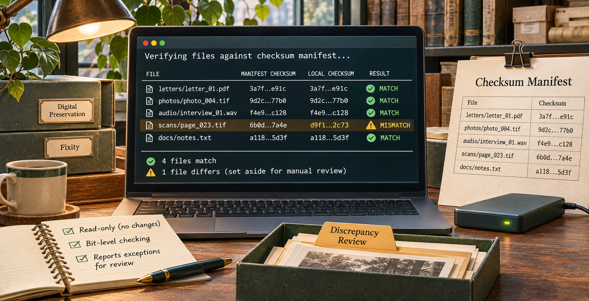

# Checksum / Fixity CLI



If you need to check whether a digital file still matches an earlier copy, a **checksum** can help. It is a short value calculated from the file's bytes. Calculate it again later and compare it with the value recorded when the file was received or stored.

This **command-line tool** runs those checks on your computer. It can calculate checksums, make a checksum list, check files against that list, and organise the results of an existing check. It does not upload files.

For example, an archive might receive `letter-001.tif` with a checksum supplied by a donor. You can calculate the file's checksum and compare the two values. A match means the bytes agree with that supplied value; a mismatch means the file or the expected value needs investigation. This is an illustrative example.

## Who might use it?

Archivists, records managers, and digital preservation staff checking transferred files or carrying out regular **fixity** checks. Fixity is the practice of checking whether digital content has stayed the same at the bit level.

## What it can do

- **Hash named files:** calculate a checksum for one or more files you specify.
- **Make a manifest:** save filenames and checksums together in a plain-text list. For example, create a record of the files in a transfer.
- **Verify a manifest:** recalculate the files' checksums and report matches, mismatches, missing files, and other exceptions.
- **Review a CSV report:** compare expected and actual checksum columns already in a report, and optionally write a full register and an exceptions list. This mode compares supplied values; it does not open or hash the listed files.

SHA-256 is the default. Use the same algorithm as the original manifest when verifying. MD5 and SHA-1 are available for older manifests and produce a warning.

## What the result means

A checksum match shows agreement with the **expected value supplied to the tool**. It does not prove a file's origin, authorship, or authenticity, and it cannot show that the expected value was trustworthy. Keep the manifest and transfer documentation with your preservation records.

The tool reads source files but does not change them. It does not follow symbolic links. A directory is processed only when you explicitly use `--recursive`, and the default limit is 10,000 files. New manifests and reports refuse existing output paths. Investigate a mismatch before deciding what to do with the file.

## Set it up with your AI agent

Copy and paste this into an agent that can work on your computer:

```text
Install the Checksum / Fixity CLI from https://github.com/matthewbrutonall/checksum-fixity-cli on my computer. Check that Python 3.10 or later is available, create a virtual environment, install the package from the repository, and verify that `fixity --help` works. Tell me how to run it. Do not hash or inspect my files yet.
```

## Run it yourself

You need Python 3.10 or later. On Linux or macOS:

```bash
git clone https://github.com/matthewbrutonall/checksum-fixity-cli.git
cd checksum-fixity-cli
python3 -m venv .venv
. .venv/bin/activate
python -m pip install .
fixity --help
```

Calculate a checksum for one named file:

```bash
fixity hash /data/transfer/letter-001.tif
```

Create a manifest for a transfer folder, then verify it later. Choose a **new** filename for the manifest:

```bash
fixity manifest /data/transfer --recursive \
  --base-dir /data/transfer \
  --output /data/reports/transfer.sha256

fixity verify --manifest /data/reports/transfer.sha256 \
  --base-dir /data/transfer
```

To organise an existing verification report:

```bash
fixity review --input verification-report.csv --output-dir review-results
```

`verify` calculates fresh checksums from files. `review` compares values already written in the CSV; choose the one that matches the evidence you have.

## Further details

Use `--format json` with a command if you need structured output. `fixity --help` and each command's `--help` show all options. Exit code `0` means no exception was reported; `4` means processing finished with discrepancies or skipped paths; `2` means invalid input; `3` means an output already exists; `1` means an internal failure.

There is also a separate [Checksum / Fixity agent skill](https://github.com/matthewbrutonall/checksum-fixity) for people who want an agent to guide the workflow. This CLI works independently of it.

For developers, run the repository's tests with:

```bash
PYTHONPATH=src python3 -m unittest discover -s tests -v
```
